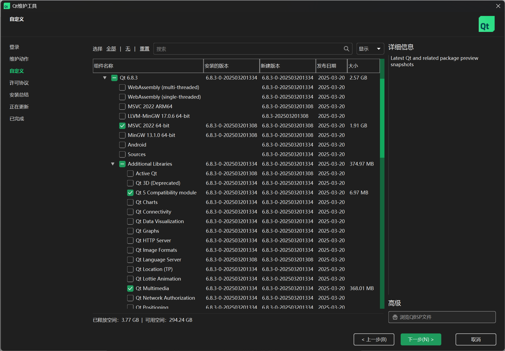
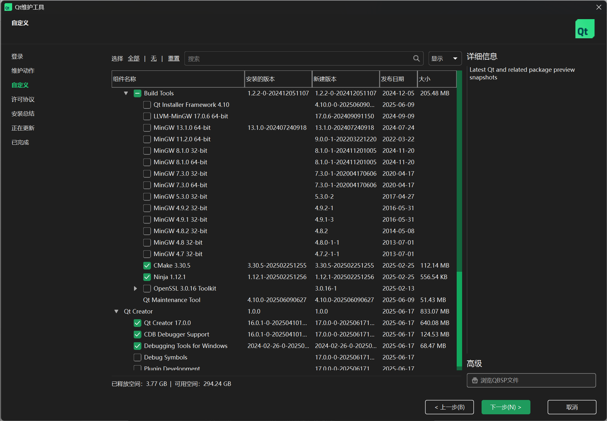

***彻底摆脱黑框框，迈入图形用户界面（GUI）！！！***

## 安装Qt

1. https://www\.qt\.io/download\-qt\-installer\-oss 访问该页面下载安装** Qt 安装器**。务必确认安装的是 LGPL 协议分发的**开源版（社区版）**，~~而非商业版，~~**~~不需要填写公司等信息~~****，仅需个人邮箱注册**。

2. 注册登录账号后选择以下组件安装：






## 介绍

Qt是一个跨平台应用开发框架（framework），它是用C\+\+语言写的一套类库。使用Qt能为

桌面计算机、服务器、移动设备甚至单片机开发各种应用（application），特别是图形用户界面

（graphicaluserinterface，GUI）程序。经过30多年的发展，Qt的使用越来越广泛，功能越来越丰

富，已成为跨平台应用开发的首选C\+\+框架。


## 开始

打开Qt Creater,你将看到如下界面：


1. 点击右上角创建项目

2. 选择Application\(Qt\)  QtWidgets Application,点击右下角选择。

3. 为你的项目取个名称

4. 构建系统选这里推荐使用 CMake，通用的跨平台构建系统，qmake是Qt 官方早期的构建工具，专门为 Qt 项目设计。通过 \.pro/\.pri 文件描述，自动处理 moc/uic/rcc 等。语法相对简单，适合纯 Qt 项目、较小项目或快速原型。

5. 然后Details不用管，下一步。语言可选可不行，影响不大。构建套件，我们一般选MSVC或MinGW,或者直接Select All kits。版本控制系统可加可不加。


好，现在你就可以看到这个界面了。


我们点击左下角的绿色三角形运行一下。看看弹出来了什么？

哇！！！一个小界面！终于不是一个黑框框，只能输入字符，输出字符了！


**我的一小步，人类的一大步——尼尔·奥尔登·阿姆斯特朗**

## 加点东西

出现的不再是一个黑框框了，但它依然是一个白框框。所以我们下面要给它加一些东西。

我们可以给它换一个图标。首先在https://www\.bitbug\.net/这个网站制做一个icon\.ico。文件，将它移动到我们项目的文件夹中。然后用它的路径创建QIcon对象，调用mainWindow的成员函数`setWindowIcon()`。

```C++
QIcon icon("E:\\work\\Qt_project\\calculator\\icon.ico");
    this->setWindowIcon(icon);
```

我们看到在main函数中创建了一个MainWindow对象w，这个w就是我们显示出来的窗口，下面一行`w.show()`，就是让这个窗口显示出来。所以我们需要去修改MainWindow类，我们在MainWindow的private属性中添加`QPushButton* button;`再在它的构造函数中添加`button = new QPushButton("click me!",this)`,显然，根据英文名可知这是一个按钮，第一个参数`"click me!"`是这个按钮的名字，第二个参数是`this`，表示这个按钮是放在这个窗口上的。

> 注意：当要使用某个组件时要先包含这个组件的库，即`#include<组件名>`
> 
> 

```C++
//mainWindow.h
#ifndef MAINWINDOW_H
#define MAINWINDOW_H

#include <QMainWindow>
#include <QPushButton>

QT_BEGIN_NAMESPACE
namespace Ui { class MainWindow; }
QT_END_NAMESPACE

class MainWindow : public QMainWindow
{
    Q_OBJECT
public:
    MainWindow(QWidget *parent = nullptr);
    ~MainWindow();
private:
    Ui::MainWindow* ui;
    QPushButton* button;
};
//mainWindow.cpp
#include "mainwindow.h"
#include "ui_mainwindow.h"

MainWindow::MainWindow(QWidget *parent)
    : QMainWindow(parent)
    , ui(new Ui::MainWindow)
{
    ui->setupUi(this);
    button = new QPushButton("click me!",this);
}

MainWindow::~MainWindow()
{
    delete ui;
}
```

我们再运行一下。


我们可以看到，在方框的左上角出现了我们刚刚创建的按钮，我们可以点击它。

但它现在在左上角，我们可以移动一下它的位置，改变一下它的大小。

```C++
button->move(200,200);            //移动到（100，200）位置处
    button->setFixedHeight(100);      //改变高度为100
    button->setFixedWidth(200);       //改变宽度为200
    //button->setFixedSize(100，200); //同时改变高度为100，宽度为200
```

同样的，我们再添加一个QLabel和一个QLineEdit

```C++
lineEdit = new QLineEdit(this);
    lineEdit->move(200,100);
    lineEdit->setFixedSize(200,50);

    label = new QLabel("QLabel",this);
    label->move(200,0);
    label->setFixedSize(200,50);
```

结果就是这样。


## 动起来

现在我们有了三个组件：一个按钮（button）、一个标签（label）、一个输入栏（lineEdit）。但我们按一下按钮，没有任何反应，下面我们要让它有反应。

首先，我们要了解Qt的两个重要的概念：信号和槽。

信号与槽是Qt编程的基础，也是Qt的一大创新。有了信号与槽的编程机制，在Qt中处理界

面上各个组件的交互操作就变得比较直观和简单

### 信号

一种对象间的事件通知机制。对象在特定事件发生时“发出”信号（emit），表示“某事发生了”。

Qt自带的组件大多都会有自己的信号，比如按钮QPushButton，当我们们点击它时，它就会发出信号`QPushButton::clicked`。同时，对我们自己创建的类也可以添加信号。

```C++
#include <QObject>

class MyClass: public QObject
{
    Q_OBJECT
public:
    MyClass();
signals:
    void mySignal();
};

```

> 注意：我们需要让类继承自QObject,或继承自QObject的类，并且在定义中加入Q\_OBJECT。
> 
> 

我们可以在对象执行某个行为后使用emit 来发出信号。

```C++
void Myclass::myClassDoSomething(){
    //...
    emit mySignal();
}
```

### 槽

槽（slot）是对信号进行响应的函数。槽就是函数，所以也称为槽函数。槽函数与一般的C\+\+

函数一样，可以具有任何参数，也可以被直接调用。槽函数与一般的函数不同的是：槽函数可以

与信号关联，当信号被发射时，关联的槽函数被自动运行。

```C++
#include <QObject>

class MyClass: public QObject
{
    Q_OBJECT
public:
    MyClass();
signals:
    void mySignal();
private slots:
    void doSomething();
};

//myClass.cpp
void MyClass::doSomething()
{
    //doSomething        
}

```

### 连接

有了信号和槽，我们就要把它们连接起来。我们一般用`connec`t函数来连接信号与槽。

```C++
connect(emiter, &signals , accecpter ,&slots);
```

我们在函数中加入4个参数，分别是：信号发送者、信号、信号接收者和槽函数。

很好理解，就是谁做了什么，谁就要做什么。

### Lambda

我们也可以用Lambda表达式来代替槽函数：

```C++
connect(emiter, &signals , accepter , [](){
        //doSomething
        })
```

### 示例

回到我们刚刚做的示例，我们可以用信号和槽来让它动起来。

比如当我们们点击按钮，label的标签就变为"you had clicked button\!"。

信号我们可以用QPushButton自带的clicked信号，槽函数就要我们自己设置。

设置好了就在MainWindow的构造函数里用connect连接起来。

```C++
//MainWindow.h
class MainWindow : public QMainWindow
{
    Q_OBJECT
//省略
private slots:
    void doSomething();
}

//MainWindow.cpp
void MainWindow::doSomething()
{
    this->label->setText("You had clicked button!");
}

//MainWindow.cpp
MainWindow::MainWindow(QWidget *parent)
    : QMainWindow(parent)
    , ui(new Ui::MainWindow)
{
   //省略
   
    connect(button,&QPushButton::clicked,this,&MainWindow::doSomething);
    //或用Lambda表达式
    //connect(button, &QPushButton::clicked, [this](){
    //    label->setText("You had clicked button!");
    //});

}

```

做完这些后再次运行它。点击我们的按钮。


当当当当当当\!

标签变成"You had clicked button\!"了。

我们在这还有一个组件QLineEdit，我们可以在这个上面输入一些句子。下面我们想把我们输入的句子放到QLabel上，但不知道怎么做。我们可以点一下QLineEdit,然后按下F1，右侧就会出现下面这个页面。这是Qt的文档库，在这里，我们可以看到关于QLineEdit这个类的信息，包括成员函数，成员变量，继承自什么等等。但是全英文，我们可以点击右上角的图标，就会弹出浏览器，我们可以用浏览器自带的翻译来阅读。


我们可以查到，QLineEdit有一个`text()`函数，可以返回写在上面的句子。我们可以用它来改一改`doSomething()`函数

```C++
void MainWindow::doSomething()
{
    // this->label->setText("You had clicked button!");
    label->setText(lineEdit->text());
}
```

下面我们再试一试，就可以达到我们的目的了。


## 做一个小玩具

这是移动，这是攻击，这是防御。好了，下面请你去打败面前的苇名弦一郎。

好，下面我们来做一个计算器。

> 注意！
> 
> 你不要看下面代码那么多，实际大多都是重复的，而且很简单。
> 
> 

### 第一步：添加组件：

按钮0\~9、负号 $ - $、点号 $.$ 、等号 $=$、数字栏和结果栏。

在MainWindow内添加，并加入QGridLayout：

```C++
QGridLayout* layout;
    QLineEdit* lineEdit;
    QLabel* operation;
    QLabel* equalSign;
    QLabel* result;

    QPushButton* btn1;
    QPushButton* btn2;
    QPushButton* btn3;
    QPushButton* btn4;
    QPushButton* btn5;
    QPushButton* btn6;
    QPushButton* btn7;
    QPushButton* btn8;
    QPushButton* btn9;
    QPushButton* btn0;

    QPushButton* btnAdd;
    QPushButton* btnSub;
    QPushButton* btnMul;
    QPushButton* btnDiv;

    QPushButton* btnDot;
    QPushButton* btnNeg;

    QPushButton* btnEqual;
```

### 第二步：初始化Ui界面。

如果全部工作都在构造函数中做的话，就太臃肿了。所以，我们一般会用一个函数`initUi`来进行这一步。

我们在\.h中声明`void initUi()`，再再\.cpp文件中实现，然后在构造函数中去调用它。

首先new对象

```Java
lineEdit = new QLineEdit(this);
    result = new QLabel("result",this);

    btn1 = new QPushButton("1",this);
    btn2 = new QPushButton("2",this);
    btn3 = new QPushButton("3",this);
    btn4 = new QPushButton("4",this);
    btn5 = new QPushButton("5",this);
    btn6 = new QPushButton("6",this);
    btn7 = new QPushButton("7",this);
    btn8 = new QPushButton("8",this);
    btn9 = new QPushButton("9",this);
    btn0 = new QPushButton("0",this);

    btnAdd = new QPushButton("+",this);
    btnSub = new QPushButton("-",this);
    btnMul = new QPushButton("*",this);
    btnDiv = new QPushButton("/",this);
    btnDot = new QPushButton(".",this);
    btnNeg = new QPushButton("-",this);
    btnEqual = new QPushButton("=",this);
```

如果这时我们试着运行一下，可以看到它们都挤在左上角中。下面我们要移动它们的位置。

我们new一个QGridLayout对象，这是Qt提供的一个布局组件，可以帮我们按网格状自动调整布局，类似的还有QVBoxLayout,QHBoxLayout,QBoxLayout。

```C++
layout = new QGridLayout(this);
    centralWidget()->setLayout(layout);
```

然后把前面的组件都添加进layout中。

addWidget\(\)函数有5个参数，第1个参数是要添加的组件的指针，第2个参数是行，第3个参数是列，第4个参数是组件所占据的行数，第5个参数是组件所占据的列数。

```C++
layout->addWidget(lineEdit, 0, 0, 1, 4);
    layout->addWidget(result, 0, 4);

    layout->addWidget(btn1, 1, 0);
    layout->addWidget(btn2, 1, 1);
    layout->addWidget(btn3, 1, 2);
    layout->addWidget(btn4, 2, 0);
    layout->addWidget(btn5, 2, 1);
    layout->addWidget(btn6, 2, 2);
    layout->addWidget(btn7, 3, 0);
    layout->addWidget(btn8, 3, 1);
    layout->addWidget(btn9, 3, 2);
    layout->addWidget(btn0, 4, 1);

    layout->addWidget(btnAdd, 1, 3);
    layout->addWidget(btnSub, 2, 3);
    layout->addWidget(btnMul, 3, 3);
    layout->addWidget(btnDiv, 4, 3);
    layout->addWidget(btnDot, 4, 2);
    layout->addWidget(btnNeg, 4, 0);
    layout->addWidget(btnEqual, 1, 4, 4, 1);

```

这时我们试着运行一下看看效果。


可以看到效果不太好，我们可以设置每个组件的SizePolicy属性。来让它填充满整个区域。

```Java
lineEdit = new QLineEdit(this);
    lineEdit->setSizePolicy(QSizePolicy::Expanding, QSizePolicy::Expanding);
    result = new QLabel("result",this);
    result->setSizePolicy(QSizePolicy::Expanding, QSizePolicy::Expanding);

    btn1 = new QPushButton("1",this);
    btn1->setSizePolicy(QSizePolicy::Expanding, QSizePolicy::Expanding);
    btn2 = new QPushButton("2",this);
    btn2->setSizePolicy(QSizePolicy::Expanding, QSizePolicy::Expanding);
    btn3 = new QPushButton("3",this);
    btn3->setSizePolicy(QSizePolicy::Expanding, QSizePolicy::Expanding);
    btn4 = new QPushButton("4",this);
    btn4->setSizePolicy(QSizePolicy::Expanding, QSizePolicy::Expanding);
    btn5 = new QPushButton("5",this);
    btn5->setSizePolicy(QSizePolicy::Expanding, QSizePolicy::Expanding);
    btn6 = new QPushButton("6",this);
    btn6->setSizePolicy(QSizePolicy::Expanding, QSizePolicy::Expanding);
    btn7 = new QPushButton("7",this);
    btn7->setSizePolicy(QSizePolicy::Expanding, QSizePolicy::Expanding);
    btn8 = new QPushButton("8",this);
    btn8->setSizePolicy(QSizePolicy::Expanding, QSizePolicy::Expanding);
    btn9 = new QPushButton("9",this);
    btn9->setSizePolicy(QSizePolicy::Expanding, QSizePolicy::Expanding);
    btn0 = new QPushButton("0",this);
    btn0->setSizePolicy(QSizePolicy::Expanding, QSizePolicy::Expanding);

    btnAdd = new QPushButton("+",this);
    btnAdd->setSizePolicy(QSizePolicy::Expanding, QSizePolicy::Expanding);
    btnSub = new QPushButton("-",this);
    btnSub->setSizePolicy(QSizePolicy::Expanding, QSizePolicy::Expanding);
    btnMul = new QPushButton("*",this);
    btnMul->setSizePolicy(QSizePolicy::Expanding, QSizePolicy::Expanding);
    btnDiv = new QPushButton("/",this);
    btnDiv->setSizePolicy(QSizePolicy::Expanding, QSizePolicy::Expanding);
    btnDot = new QPushButton(".",this);
    btnDot->setSizePolicy(QSizePolicy::Expanding, QSizePolicy::Expanding);
    btnNeg = new QPushButton("-",this);
    btnNeg->setSizePolicy(QSizePolicy::Expanding, QSizePolicy::Expanding);
    btnEqual = new QPushButton("=",this);
    btnEqual->setSizePolicy(QSizePolicy::Expanding, QSizePolicy::Expanding);
```


嗯，这样就好看多了。

### 第三步：实现业务逻辑

#### 首先我们要让我们按下按钮后，输入栏lineEdit可以添加数字。

信号我们用QPushButton自带的clicked，槽函数就要我们自己构造了。

我们先声明一个槽函数`void numberClicked(int num)`,

```Java
private slots:
    void numberClicked(int num);
```

再去实现它。

我们设置lineEdit内的字符串为它本身加上数字num转化为字符。

***注意：lineEdit可以输入数字，也可以输入字符。我们要让它只能输入数字。我们可以设置它为只能输入可转化为浮点数的字符： ***

**`lineEdit->setValidator(new QDoubleValidator);`**

```C++
void MainWindow::numberClicked(int num){
    lineEdit->setText(lineEdit->text() + QString::number(num));
}
```

再把它和clicked信号连接起来，同初始化Ui一样，我们也构建一个初始化连接的函数`void initConnect()`

我们这里用Lambda表达式。

```JavaScript
void MainWindow::initConnect(){
    // 连接数字按钮和数字输入槽函数
    connect(btn0, &QPushButton::clicked, [this](){ numberClicked(0); });
    connect(btn1, &QPushButton::clicked, [this](){ numberClicked(1); });
    connect(btn2, &QPushButton::clicked, [this](){ numberClicked(2); });
    connect(btn3, &QPushButton::clicked, [this](){ numberClicked(3); });
    connect(btn4, &QPushButton::clicked, [this](){ numberClicked(4); });
    connect(btn5, &QPushButton::clicked, [this](){ numberClicked(5); });
    connect(btn6, &QPushButton::clicked, [this](){ numberClicked(6); });
    connect(btn7, &QPushButton::clicked, [this](){ numberClicked(7); });
    connect(btn8, &QPushButton::clicked, [this](){ numberClicked(8); });
    connect(btn9, &QPushButton::clicked, [this](){ numberClicked(9); });
}
```

同样设立点号和负号，然后连接。

```JavaScript
// 小数点按钮点击事件
void MainWindow::dotClicked(){
    if(!lineEdit->text().contains('.')){
        lineEdit->setText(lineEdit->text() + ".");
    }
}

// 负号按钮点击事件
void MainWindow::negClicked(){
    if(lineEdit->text().startsWith('-')){
        lineEdit->setText(lineEdit->text().remove(0,1));
    } else {
        lineEdit->setText("-" + lineEdit->text());
    }
}
```


#### 下面我们设置运算符按钮。

我们给mainWindow添加一个私有成员`int operationType = 0;`我们约定，1为\+，2为\-，3为\*，4为/。然后我们构建函数  `void setOperation(int op);`并在设置结束后删除lineEdit中的内容。

```C++
// 设置运算类型 1加 2减 3乘 4除
void MainWindow::setOperation(int op){
    if(!lineEdit->text().isEmpty()){
        lastNum = lineEdit->text().toDouble();
    }
    switch(op){
        case 1:
            operationType = 1;
            break;
        case 2:
            operationType = 2;
            break;
        case 3:
            operationType = 3;
            break;
        case 4:
            operationType = 4;
            break;
    }
    lineEdit->clear();
}
```

我们把它和信号连接起来。

```C++
// 连接运算符按钮和运算槽函数
    connect(btnAdd, &QPushButton::clicked, [this](){ setOperation(1); });
    connect(btnSub, &QPushButton::clicked, [this](){ setOperation(2); });
    connect(btnMul, &QPushButton::clicked, [this](){ setOperation(3); });
    connect(btnDiv, &QPushButton::clicked, [this](){ setOperation(4); });
```


#### 最后我们开始运算

用计算器的顺序一般是先在输入栏中输入数字，然后按运算符，再输入数字，最后按等号，输出结果。

所以我们要有一个成员变量记录最后输入的数字，默认为0。`double lastNum = 0;`

函数具体实现：

```C++
// 计算按钮点击事件
void MainWindow::calculate(){
    double num2 = lineEdit->text().toDouble();
    double num1 = lastNum;
    double res = 0.0;

    switch(operationType){
        case 1:
            res = num1 + num2;
            break;
        case 2:
            res = num1 - num2;
            break;
        case 3:
            res = num1 * num2;
            break;
        case 4:
            if(num2 != 0){
                res = num1 / num2;
            } else {
                result->setText("Error: Div by 0");
                return;
            }
            break;
        default:
            result->setText("Error: No Op");
            return;
    }

    result->setText(QString::number(res));
    lastNum = res;
    lineEdit->clear();

}
```

最后连接信号和槽。

```C++
connect(btnEqual, &QPushButton::clicked, this, &MainWindow::calculate);
```

## 完整代码：

你可以直接复制粘贴下来，就可以运行了。

```C++
//main.cpp
#include "mainwindow.h"

#include <QApplication>

int main(int argc, char *argv[])
{
    QApplication a(argc, argv);
    MainWindow w;
    w.show();
    return a.exec();
}

```

```C++
//mainWindow.h
#ifndef MAINWINDOW_H
#define MAINWINDOW_H

#include <QMainWindow>
#include <QGridLayout>
#include <QLineEdit>
#include <QLabel>
#include <QPushButton>
#include <QIntValidator>

QT_BEGIN_NAMESPACE
namespace Ui { class MainWindow; }
QT_END_NAMESPACE

class MainWindow : public QMainWindow
{
    Q_OBJECT

public:
    MainWindow(QWidget *parent = nullptr);
    ~MainWindow();

private:
    Ui::MainWindow *ui;

    void initUi();
    void initConnect();

    QGridLayout* layout;
    QLineEdit* lineEdit;
    QLabel* operation;
    QLabel* equalSign;
    QLabel* result;

    QPushButton* btn1;
    QPushButton* btn2;
    QPushButton* btn3;
    QPushButton* btn4;
    QPushButton* btn5;
    QPushButton* btn6;
    QPushButton* btn7;
    QPushButton* btn8;
    QPushButton* btn9;
    QPushButton* btn0;

    QPushButton* btnAdd;
    QPushButton* btnSub;
    QPushButton* btnMul;
    QPushButton* btnDiv;

    QPushButton* btnDot;
    QPushButton* btnNeg;

    QPushButton* btnEqual;

    int operationType = 0; // 1:Add, 2:Sub, 3:Mul, 4:Div
    double lastNum = 0;

private slots:
    void setOperation(int op);
    void numberClicked(int num);
    void dotClicked();
    void negClicked();
    void calculate();
    
};
#endif // MAINWINDOW_H
```

```C++
//mainWindow.cpp
#include "mainwindow.h"
#include "ui_mainwindow.h"

MainWindow::MainWindow(QWidget *parent)
    : QMainWindow(parent)
    , ui(new Ui::MainWindow)
{
    ui->setupUi(this);
    
    setWindowTitle("calculator");
    QIcon icon("E:\\work\\Qt_project\\calculator\\icon.ico"); //修改为你自己的路径
    this->setWindowIcon(icon);

    initUi();
    initConnect();

}

MainWindow::~MainWindow()
{
    delete ui;
}

// 初始化UI界面
void MainWindow::initUi(){
    layout = new QGridLayout(this);
    centralWidget()->setLayout(layout);

    layout->setContentsMargins(0, 0, 0, 0);

    lineEdit = new QLineEdit(this);
    lineEdit->setSizePolicy(QSizePolicy::Expanding, QSizePolicy::Expanding);
    result = new QLabel("result",this);
    result->setSizePolicy(QSizePolicy::Expanding, QSizePolicy::Expanding);

    btn1 = new QPushButton("1",this);
    btn1->setSizePolicy(QSizePolicy::Expanding, QSizePolicy::Expanding);
    btn2 = new QPushButton("2",this);
    btn2->setSizePolicy(QSizePolicy::Expanding, QSizePolicy::Expanding);
    btn3 = new QPushButton("3",this);
    btn3->setSizePolicy(QSizePolicy::Expanding, QSizePolicy::Expanding);
    btn4 = new QPushButton("4",this);
    btn4->setSizePolicy(QSizePolicy::Expanding, QSizePolicy::Expanding);
    btn5 = new QPushButton("5",this);
    btn5->setSizePolicy(QSizePolicy::Expanding, QSizePolicy::Expanding);
    btn6 = new QPushButton("6",this);
    btn6->setSizePolicy(QSizePolicy::Expanding, QSizePolicy::Expanding);
    btn7 = new QPushButton("7",this);
    btn7->setSizePolicy(QSizePolicy::Expanding, QSizePolicy::Expanding);
    btn8 = new QPushButton("8",this);
    btn8->setSizePolicy(QSizePolicy::Expanding, QSizePolicy::Expanding);
    btn9 = new QPushButton("9",this);
    btn9->setSizePolicy(QSizePolicy::Expanding, QSizePolicy::Expanding);
    btn0 = new QPushButton("0",this);
    btn0->setSizePolicy(QSizePolicy::Expanding, QSizePolicy::Expanding);

    btnAdd = new QPushButton("+",this);
    btnAdd->setSizePolicy(QSizePolicy::Expanding, QSizePolicy::Expanding);
    btnSub = new QPushButton("-",this);
    btnSub->setSizePolicy(QSizePolicy::Expanding, QSizePolicy::Expanding);
    btnMul = new QPushButton("*",this);
    btnMul->setSizePolicy(QSizePolicy::Expanding, QSizePolicy::Expanding);
    btnDiv = new QPushButton("/",this);
    btnDiv->setSizePolicy(QSizePolicy::Expanding, QSizePolicy::Expanding);
    btnDot = new QPushButton(".",this);
    btnDot->setSizePolicy(QSizePolicy::Expanding, QSizePolicy::Expanding);
    btnNeg = new QPushButton("-",this);
    btnNeg->setSizePolicy(QSizePolicy::Expanding, QSizePolicy::Expanding);
    btnEqual = new QPushButton("=",this);
    btnEqual->setSizePolicy(QSizePolicy::Expanding, QSizePolicy::Expanding);

    layout->addWidget(lineEdit, 0, 0, 1, 4);
    layout->addWidget(result, 0, 4);

    layout->addWidget(btn1, 1, 0);
    layout->addWidget(btn2, 1, 1);
    layout->addWidget(btn3, 1, 2);
    layout->addWidget(btn4, 2, 0);
    layout->addWidget(btn5, 2, 1);
    layout->addWidget(btn6, 2, 2);
    layout->addWidget(btn7, 3, 0);
    layout->addWidget(btn8, 3, 1);
    layout->addWidget(btn9, 3, 2);
    layout->addWidget(btn0, 4, 1);

    layout->addWidget(btnAdd, 1, 3);
    layout->addWidget(btnSub, 2, 3);
    layout->addWidget(btnMul, 3, 3);
    layout->addWidget(btnDiv, 4, 3);
    layout->addWidget(btnDot, 4, 2);
    layout->addWidget(btnNeg, 4, 0);
    layout->addWidget(btnEqual, 1, 4, 4, 1);

    lineEdit->setValidator(new QDoubleValidator);

}

// 初始化信号和槽函数连接
void MainWindow::initConnect(){
    // 连接数字按钮和数字输入槽函数
    connect(btn0, &QPushButton::clicked, [this](){ numberClicked(0); });
    connect(btn1, &QPushButton::clicked, [this](){ numberClicked(1); });
    connect(btn2, &QPushButton::clicked, [this](){ numberClicked(2); });
    connect(btn3, &QPushButton::clicked, [this](){ numberClicked(3); });
    connect(btn4, &QPushButton::clicked, [this](){ numberClicked(4); });
    connect(btn5, &QPushButton::clicked, [this](){ numberClicked(5); });
    connect(btn6, &QPushButton::clicked, [this](){ numberClicked(6); });
    connect(btn7, &QPushButton::clicked, [this](){ numberClicked(7); });
    connect(btn8, &QPushButton::clicked, [this](){ numberClicked(8); });
    connect(btn9, &QPushButton::clicked, [this](){ numberClicked(9); });

    //连接小数点和负号按钮和槽函数
    connect(btnDot, &QPushButton::clicked, this, &MainWindow::dotClicked);
    connect(btnNeg, &QPushButton::clicked, this, &MainWindow::negClicked);

    // 连接运算符按钮和运算槽函数
    connect(btnAdd, &QPushButton::clicked, [this](){ setOperation(1); });
    connect(btnSub, &QPushButton::clicked, [this](){ setOperation(2); });
    connect(btnMul, &QPushButton::clicked, [this](){ setOperation(3); });
    connect(btnDiv, &QPushButton::clicked, [this](){ setOperation(4); });

    // 连接等号按钮和计算槽函数
    connect(btnEqual, &QPushButton::clicked, this, &MainWindow::calculate);
}

// 设置运算类型 1加 2减 3乘 4除
void MainWindow::setOperation(int op){
    if(!lineEdit->text().isEmpty()){
        lastNum = lineEdit->text().toDouble();
    }
    switch(op){
        case 1:
            operationType = 1;
            break;
        case 2:
            operationType = 2;
            break;
        case 3:
            operationType = 3;
            break;
        case 4:
            operationType = 4;
            break;
    }
    lineEdit->clear();
}

// 数字按钮点击事件
void MainWindow::numberClicked(int num){
    lineEdit->setText(lineEdit->text() + QString::number(num));
}

// 小数点按钮点击事件
void MainWindow::dotClicked(){
    if(!lineEdit->text().contains('.')){
        lineEdit->setText(lineEdit->text() + ".");
    }
}

// 负号按钮点击事件
void MainWindow::negClicked(){
    if(lineEdit->text().startsWith('-')){
        lineEdit->setText(lineEdit->text().remove(0,1));
    } else {
        lineEdit->setText("-" + lineEdit->text());
    }
}

// 计算按钮点击事件
void MainWindow::calculate(){
    double num2 = lineEdit->text().toDouble();
    double num1 = lastNum;
    double res = 0.0;

    switch(operationType){
        case 1:
            res = num1 + num2;
            break;
        case 2:
            res = num1 - num2;
            break;
        case 3:
            res = num1 * num2;
            break;
        case 4:
            if(num2 != 0){
                res = num1 / num2;
            } else {
                result->setText("Error: Div by 0");
                return;
            }
            break;
        default:
            result->setText("Error: No Op");
            return;
    }

    result->setText(QString::number(res));
    lastNum = res;
    lineEdit->clear();

}

```


> 最后如果还有不少时间，带大家看看免试题。
> 
> 

