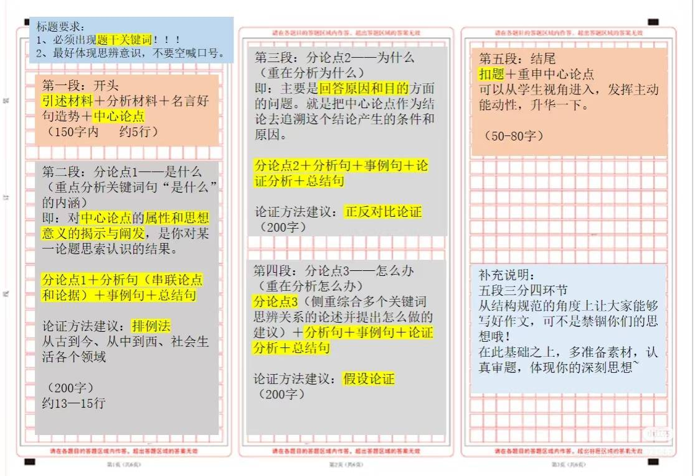

## 引言：大家可以看到这样一张图，是高中语文作文的一个常见的模板。



那么什么是模板？来自豆包的回答是：模板是预先制定的、具有固定结构和格式的标准化框架，核心作用是为重复性行为或内容创作提供“基础篮本”，使用者可根据具体需求填充个性化内容，减少重复搭建框架的成本。

而在C\+\+中，也提供了这样的功能。

例如：我们想设计一个add函数，返回两个数的总和，我们会这样写

```C++
int add(int a,int b){
    return a + b;
}
```

对这个函数，我们输入两个int类型的数字，返回一个int类型的数字。但我们时常还需要输入两个double类型的数字，返回一个double类型的数字，于是我们就要再写一个一模一样的函数，只有变量的类型不同，在C\+\+中可以用重载来只改变类型，在C语言中则连函数名也需要更改，此外我们还要写（float，float）（string，string）类型的函数，这就多了许多重复的工作，而在C\+\+中我们可以通过模板来避免这些重复的工作。

```C++
template<typename T>
T add(T a, T b){
    return a + b;
} 

int main(){
    int intSum = add(5,6);
    double doubleSum = add(5.0,6.0);
    std::cout << intSum << std::endl;  //11
    std::cout << doubleSum << std::endl;  //11.0
    return 0;
}
    
```

## 函数模板

上述函数就是一个典型的函数模板，看起来很简单。

要声明一个函数模板，我们通常要用：

```C++
template < 形参列表 >
函数声明
```

我们前面示例中的形参列表是 `typename T`，关键字 typename 顾名思义，引入了一个类型形参。类型形参是 T，也可以使用其他标识符作为类型形参名（T 或 Ty 等，是约定的惯例），你也可以在需要的时候自定义一些有明确意义的名字。

为什么称为列表呢？因为可以输入多个类型形参。

```C++
template<typename T,typename U>
void print(T first, U second){
    std::cout<< "the first is: " << first <<", the second is: " << second << std::endl;
}


int main(){
    print(5, 6.0);                    //the first is: 5, the second is: 6
    print('A', "Hello, Templates!");  //the first is: A, the second is: Hello, Templates!
    return 0;
}
```


## 类模板

有函数模板，同样的也有类模板。下面是一个类模板，它和普通类的区别只是多了一个`template<typename T>`

```C++
template<typename T>
class Test{};
```

和函数模板一样，其实类模板的语法也就是：

```C++
template< 形参列表 > 
类声明
```

下面是一个简单的Pair类：

```C++
template<typename T,typename U>
class Pair{
public:
    T first;
    U second;
    Pair(T a, U b): first(a), second(b){};
    
    void print() const{
        std::cout << "Pair: " << first << ", " << second << std::endl;
    }
}；

int main(){
    Pair pair<int,double>(5,6.0);
    pair.print();  //Pair: 5, 6
    return 0;
}
```

嗯，这看起来跟寻常类的使用方法一样，只是在需要在创建对象时加上\<形参列表\>来声明参数类型。上述代码把对象的成员函数声明和实现写在了一起。通常情况下，我们会把成员函数的声明写在\.h文件中，把具体的实现写在\.cpp文件中，我们也这样试试。

结果并不能运行，我们看看报错：

Visual studio：


Visual studio code：


注意到这里是LNK2019,一般来说，LNK报错都是链接问题，也就是说这里链接失败。为什么呢？

## 变量模板

在C\+\+14以后加入了变量模板。

```C++
template<typename T>
    T v;

int main() {
    v<int> = 10;
    std::cout << v<int> << std::endl;

    return 0;
}
```

如上，就这么简单，毫无难度。当然了，既然是变量，自然可以有各种的修饰，比如 `constexpr`

**注意**：我们这边把v定义在main函数外面，因为模板声明只能在全局、命名空间或类范围。

我们在声明`v<int>=10`,在使用时仍需要用v\<int\>，而非直接用v

\>\>\>\>\>\>\>\>\>\>\>\>\>\>\>\>\>\>\>\>\>\>\>\>\>\>\>\>\>\>\>\>\>\>\>\>\>\>\>\>\>\>\>\>\>\>\>\>\>\>\>\>\>\>\>\>\>\>\>\>\>\>\>\>

> constexpr表示某个变量或函数（或构造函数、成员函数等）可以在编译期求值，从而在需要常量的上下文（如数组大小、模板非类型参数、static\_assert 等）中使用。
> 
> 它的主要用途包括：
> 
> **常量表达式**：`constexpr` 变量必须在声明时初始化，并且其类型必须是字面类型。 
> 
> **函数**：可以将函数声明为 `constexpr`，以便在编译时计算其返回值。 
> 
> **与 const 的区别**：与 `const` 不同，`constexpr` 不仅可以用于变量，还可以用于函数和类构造函数，指示该值或返回值是常量，并尽可能在编译时计算。 
> 在 C14 和 C20 中，`constexpr` 的使用范围和限制有所变化，具体要求可以参考相关文档。
> 
> 


## 实例化（显示和隐式）

首先介绍实例化：实例化就是“从类（或模板、类型）创建一个具体的对象（实例）”的过程。类是蓝图，实例是按蓝图造出来的东西；实例有自己的状态（成员变量）和行为（方法）。

我们在main函数中创建对象或调用模板函数，编译器编译时把模板参数代入模板定义，生成一个具体的类或函数（称为一个特化 specialization）。这是在编译期发生的（编译器生成类型信息和/或函数体的机器码或中间表示）。

例如：当编译器看到 `Pair<int,double>`，会把模板里的 T\-\>int, U\-\>double 替换并生成 Pair\<int,double\> 类型和它的成员函数。

程序运行时，使用该具体类型创建对象（在栈上或堆上），分配内存并调用构造函数完成初始化。

例如：`Pair<int,double> pair; `—— 这里才是真正创建了一个对象 pair。

我们需注意：

函数模板不是函数，只有实例化函数模板，编译器才能生成实际的函数定义。不过在很多时候，它看起来就像普通函数一样。

类模板不是类，只有实例化类模板，编译器才能生成实际的类。

变量模板不是变量，只有实例化的变量模板，编译器才会生成实际的变量。变量模板实例化后简单的说就是一个全局变量，所以也不用担心生存期的问题。

回到之前的问题，当我们创建对象时，编译器会先实例化一个Pair\<int , double\>类，这个类有print\<int first, double second\>的声明，print\<T first , U second\>的定义在\.cpp文件中，没有被实例化为print\<int first, double second\>,在链接时找不到print\<int first , double second\>。于是就会发出链接错误。

实例化又分为显式实例化和隐式实例化。

显式实例化（explicit instantiation）：由程序员通过语法显式告诉编译器“现在就为这些模板参数实例化（或在本翻译单元声明已由别处实例化）”。

通过显示实例化我们可以解决模板分文件问题,例如：

```C++
//myClass.h
template<typename T>
class MyClass{
public:
    void doingSomething();
}

//myClass.cpp
template<typename T>
void MyClass<T>::doingSomething(){
    std::cout << "Doing something with " << typeid(T).name() << std::endl;  
}         //typeid(T).name()  返回T的类型

template class MyClass<int>;
template class MyClass<double>;

//main.cpp
int main() {
    MyClass<int> objInt;
    objInt.doingSomething();     //Doing something with int

    MyClass<double> objDouble;
    objDouble.doingSomething();  //Doing something with double

    return 0;
}
```

**注意事项：**

- 显式实例化需要在模板定义后进行。

- 只有显式实例化的类型在未实例化时可用于模板分离。

- 未显式实例化的类型可能导致链接错误。

隐式实例化（implicit instantiation）：编译器在遇到对模板的具体使用（比如使用 Pair\<int , double\>、调用 Pair\<int , int\>）时，自动为该具体类型“生成”模板实体（类/函数的具体定义）。你不需要写任何额外代码，编译器按需实例化出需要的成员。

## 模板参数

模板参数就是写在模板定义那里的占位符，用来在实例化时传入具体的东西（类型或值或另一个模板），从而让同一份模板代码能针对不同的“参数”生成不同的类型或函数。

模板参数决定了模板的泛用性与灵活性。C\+\+ 模板参数种类主要包括类型参数、非类型参数和模板模板参数。

### 类型参数

类型参数用于表示任意类型，在模板实例化时被具体的类型替代。简单来说就是`template<typename T>`中的T。对于这个T，我们可以像对普通函数的参数设置默认值一样对它设置默认类型。当我们没有设置T时，T就会自动变为默认类型。

```C++
template<typename T= int>
void print(){
    std::cout << "The type is " << typeid(T).name() << std::endl;
}

int main(){
    print();                            //The type is int
    print<std::vector<int>>();          //The type is class std::vector<int,class std::allocator<int> >
    return 0;
}
```

> 注意这里的std::vector\<int\>类型为一长串。
> 
> 

### 非类型参数

非类型参数允许模板接受非类型的值，如整数、指针或引用。

如下实例，我们定义了一个FixArray类用来储存固定数量的整数，在类声明中定义了一个成员变量：T类型的数组，数组大小为N，又在构造函数中把数组中的数都设为a，最后用`print()`函数输出出来。其中数组的大小是我们在`FixArray<int , 5>` 中设置的。

> 同上，这里的N也是可以设置默认值的。
> 
> 

```C++
template<typename T, int N>
class FixArray{
public:
    T data[N];
    FixArray(int a);
    void print();
};

template<typename T, int N>
FixArray<T, N>::FixArray(int a){
    for(int i=0; i<N; i++){
        data[i] = a;
    }
}

template<typename T, int N>
void FixArray<T, N>::print(){
    for(int i=0; i<N; i++){
        std::cout << data[i] << " ";
    }
    std::cout << std::endl;
}

int main(){
    FixArray<int, 5> fixArray(1);
    fixArray.print();      //1 1 1 1 1
    return 0;
}

```

**注意事项：**

- 非类型参数必须是编译期常量。

- 允许的类型包括整型、枚举、指针、引用等，但不包括浮点数和类类型。

### 模板模板参数

模板模板参数允许模板接受另一个模板作为参数。这对于抽象容器和策略模式等场景非常有用。

下面是一个简单的例子：容器适配器。

我们解释一下第一行：

最外层的`template<>`是对ContainerPrinter类的模板声明；\<\>里面被逗号分为两个参数，第一个参数

`template <typename T1, typename T2> class Container`，前面的`template <typename T1, typename T2>`是对后面的` class Container`声明是一个模板,是一个接收两个类型参数的模板，后一个`class`是声明类型名称，`Container`是类型名称，类似于寻常的T，但准确来说是模板名称，因为我们前面说过这里声明的是一个模板。

我们再解释一下print函数的参数：

const 和\&就是简单的常数和引用，中间的 `Container<T, std::allocator<T>>` 就是第一行的模板声明中的第一个参数，Container是模板名称，\<\>里的就分别是`typename T1` 和`typename T2`。回到前文提到的std::vector\<int\>的类型`class std::vector<int,class std::allocator<int> >`，与这里是一致的，可以见得，C\+\+ 标准库里的 std::vector 本质上就是一个类模板。你看到的具体类型像 std::vector\<int\>、std::vector\<std::string\>都是由这个模板“实例化”出来的具体类型。

```C++
template<template <typename T1, typename T2> class Container , typename T>
class ContainerPrinter {
public:
    void print(const Container<T, std::allocator<T>>& container){
        for(auto& element : container){
            std::cout << element << " ";
        }
        std::cout << std::endl;
    }
};
int main(){

    std::vector<int> vec = {1, 2, 3, 4, 5};
    ContainerPrinter<std::vector, int> vecPrinter;
    vecPrinter.print(vec);                    //1 2 3 4 5

    std::list<int> list = {6, 7, 8, 9, 10};
    ContainerPrinter<std::list, int> listPrinter;
    listPrinter.print(list);                 //6 7 8 9 10

    return 0;
}

```


## 模板特化

给出这样一个函数模板 `func`，你可以看到，它的逻辑是返回两个对象相加的结果。

```C++
template<typename T>
T func(const T& a, const T2& b){
    return a + b
}
```

那么如果我有一个需求：**“如果我传的是一个 double 一个 int 类型，那么就让它们返回相减的结果”**。这种定制的需求很常见，此时我们就需要使用到模板全特化：

```C++
template<>
auto f(const double& a, const int& b){
    return a - b;
}
```

模板特化允许开发者为特定类型或类型组合提供专门的实现。当通用模板无法满足特定需求时，特化模板可以调整行为以处理特定的情况。C\+\+ 支持**全特化（Full Specialization）\******和\******偏特化（Partial Specialization）**，但需要注意的是，**函数模板不支持偏特化**，只能进行全特化。

### 全特化

全特化是针对模板参数的完全特定类型组合。它提供了模板的一个特定版本，当模板参数完全匹配特化类型时，编译器将优先使用该特化版本。


allocater


显示实例化和特化有什么区别？


decltype


模板实例化（显示实例化\+隐式实例化）


模板分文件


函数模板与非函数模板重载

函数模板与非模板函数可以重载。

函数模板特列化和函数模板重载有什么区别？


constexpr概念      // C\+\+ 17 

